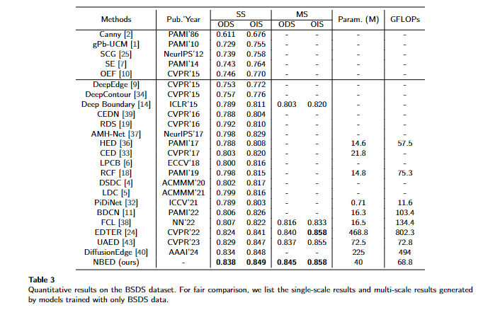
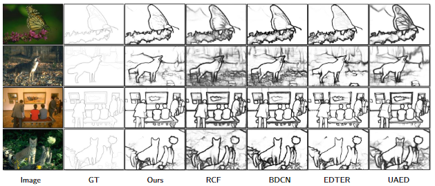

# NBED
Code of paper [A new baseline for edge detection: Make Encoder-Decoder great again](https://arxiv.org/pdf/2409.14976)


## UPDATE  
### release the ckpt of BIPED
checkpoint on BIPED is [here](https://drive.google.com/file/d/1IJO3VYrzi1Rp6YS4CzawZTrggxzz5cBx/view?usp=drive_link)  
### Fix bugs
ODS/OIS on BIPED is a little error, due to a wrong tolerance is used. And it is corrected in [version 2](https://arxiv.org/pdf/2409.14976)  Thanks for the reminder from [yx-yyds](https://github.com/yx-yyds)

### **We released [DDN](https://github.com/Li-yachuan/DDN), the follow-up work of NBED.**
Main features: By introducing Evidence Lower Bound loss and learnable Gaussian distributions, DDN is capable of generating multi-granularity edges. The ODS of DDN on the BSDS500 dataset is 0.867, which is 0.022 higher than that of NBED (0.845)

### 2026.04.11 The paper has appeared in _Signal Processing: Image Communication_
If you find this project useful in your research, please consider citing our paper:
```bibtex
@article{LI2026117485,
title = {A new baseline for edge detection: Make encoder–decoder great again},
journal = {Signal Processing: Image Communication},
volume = {142},
pages = {117485},
year = {2026},
issn = {0923-5965},
doi = {https://doi.org/10.1016/j.image.2026.117485},
url = {https://www.sciencedirect.com/science/article/pii/S0923596526000081},
author = {Yachuan Li and Xavier Soria Poma and Yongke Xi and Guanlin Li and Chaozhi Yang and Qian Xiao and Yun Bai and Zongmin Li}
}
```


## 0. Pip environment

```
pip install -r requirements.txt
```

## 1. Test NBED  
Modify the values of ckpt and img in inference.py. ckpt on BSDS can be found from 
https://drive.google.com/file/d/1TKg37m3KWuv4A8FTlXJ-N20Ar46PmRdH/view?usp=sharing
And running command
```
python inference.py
```

## 2. Training NBED
### 2.1 Preparing the dataset
Download the dataset to any dir and point to the dir in the code  
-BSDS500 following the setting of "The Treasure Beneath Multiple Annotations: An Uncertainty-aware Edge Detector"  
-NYUDv2 following the setting of "Pixel Difference Networks for Efficient Edge Detection"  and random crop to 400*400  
-BIPED following the setting of "Dense Extreme Inception Network for Edge Detection"  
### 2.2 Preparing the pretrained weights
Down it from https://huggingface.co/sail/dl/resolve/main/caformer/caformer_m36_384_in21ft1k.pth
and put it into the dir ./model
### 2.3 Training NBED
```
python main.py --batch_size 4 --stepsize 3-4 --gpu 1 --savedir 0305-bsds --encoder Dul-M36 --decoder unetp --head default --note 'training on BSDS500' --dataset BSDS --maxepoch 6
```
### 2.4 Eval NBED
Following the previous methods. such as RCF and PiDiNet




The result of BSDS500 can be download here
https://drive.google.com/file/d/1PiPklsH7w6zNxdGWW-JpnUsFOdiYLHwG/view?usp=sharing

# Acknowledgement & Citation

```angular2html
@inproceedings{liu2017richer,
  title={Richer convolutional features for edge detection},
  author={Liu, Yun and Cheng, Ming-Ming and Hu, Xiaowei and Wang, Kai and Bai, Xiang},
  booktitle={Proceedings of the IEEE conference on computer vision and pattern recognition},
  pages={3000--3009},
  year={2017}
}
```

```angular2html
@inproceedings{poma2020dense,
  title={Dense extreme inception network: Towards a robust cnn model for edge detection},
  author={Poma, Xavier Soria and Riba, Edgar and Sappa, Angel},
  booktitle={Proceedings of the IEEE/CVF winter conference on applications of computer vision},
  pages={1923--1932},
  year={2020}
}
```
```
@inproceedings{zhou2024muge,
  title={Muge: Multiple granularity edge detection},
  author={Zhou, Caixia and Huang, Yaping and Pu, Mengyang and Guan, Qingji and Deng, Ruoxi and Ling, Haibin},
  booktitle={Proceedings of the IEEE/CVF Conference on Computer Vision and Pattern Recognition},
  pages={25952--25962},
  year={2024}
}
```


